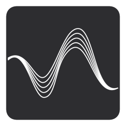
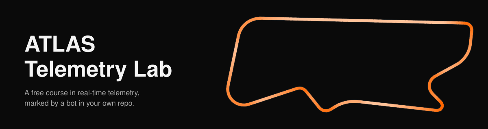

<p align="center"></p>
<p align="center"></p>

<p align="center">


</p>

ATLAS Telemetry Lab is a free course in Motion Applied's ATLAS Open Streaming.
It has four modules. You work against a Kafka broker, a streaming API and a
synthetic race car, in a copy of this repository that you own. A bot checks
each pull request and moves you to the next module when it passes. There is nothing
to license or install.

## Start

**Do not clone this repository, and do not fork it.**

1. Make your own copy. Click `Use this template` → `Create a new repository` at
   the top of this page. Name it whatever you like. You open pull requests
   against your copy, and the bot commits your progress to it.
2. Open a Codespace on your copy. `Code` → `Codespaces` →
   `Create codespace on main`. The first build takes a few minutes while it
   installs Docker, Python and Node.
3. Run `lab`. The terminal runs it for you on first open. It prints where you
   are and what to do next.

## Never used Codespaces?

A Codespace is VS Code in your browser, on a machine GitHub runs for you.
Nothing is installed on your computer.

After you click `Create codespace on main` you see a build log for a few
minutes, then the editor, then a terminal that prints the greeting. Closing
the tab does not lose work. Open the Codespace again from `Code` →
`Codespaces` and it resumes where you left off. To stop it yourself and save
your allowance, use `Code` → `Codespaces` → `…` → `Stop codespace`.

GitHub's own pages cover the rest: the
[Codespaces quickstart](https://docs.github.com/en/codespaces/getting-started/quickstart)
and
[stopping and starting a codespace](https://docs.github.com/en/codespaces/developing-in-a-codespace/stopping-and-starting-a-codespace).

This is what the terminal looks like after the first build.



## The commands

| Command | What it does |
|---|---|
| `lab` | Where you are and what to do next |
| `lab explain` | Why this module works the way it does, with the real protobuf |
| `lab check` | Runs the validator locally, in seconds. Nothing is pushed |
| `lab submit` | Branches, pushes, opens the pull request and waits for the verdict |
| `lab share` | Turns anonymous progress reporting on or off |

`lab check` runs the same checks as the bot. If it passes locally, it passes in
CI. `lab submit` waits for the bot, prints its comment in your terminal, and
moves you to the next module once the pull request merges. You do not need to
`git pull`.

---

> **Already in your own copy and still seeing this page?** The welcome workflow
> has not run. Nothing is broken. Open the Codespace and run `lab`; it tells you
> where you are. To restore the guided README, run the `welcome` workflow from
> the `Actions` tab.

## Sharing your progress (optional, off by default)

The course sends no data unless you opt in. The first time you run
`lab submit`, it asks whether to share anonymous progress with the course
authors. Answer no, or ignore the prompt, and it sends nothing.

If you opt in, each time the bot grades a pull request in your repository it
sends:

- the module number, and whether it passed or failed;
- the course name and template version;
- a random ID generated for your copy.

The report contains no GitHub username, repository name, or code. It runs in
your own GitHub Actions. [`.lab/report.py`](.lab/report.py) builds the payload
and sends it. Motion Applied stores nothing; the event exists only in Google
Analytics. It has no effect on your grade.

Change the setting at any time. It takes effect on your next submit.

```bash
lab share on       # start sharing
lab share off      # stop
lab share status   # what it is set to now
```

The [privacy page](https://atlastelemetrylab.netlify.app/privacy/) covers this
and what the site itself collects.

## What the modules teach

The course covers the layer between a Kafka topic and a time-series database.
Neither provides it, and teams rebuild it by hand on every project.

| Module | What you do | What it is about |
|---|---|---|
| 1 | Make it yours | Sessions. A session has a name, a start, an end and a configuration |
| 2 | Add a channel | Parameter definitions. Identity, units, range, rate, in-band |
| 3 | Fix the broken producer | Contiguous time. A failure that reports success |
| 4 | Write your first consumer | Reading a stream you were never told the shape of |

## Understanding it, not just passing it

Each module has a `lab explain` topic behind it. There are eight topics in
total: sessions, parameters, timestamps, packets, configuration, streams, the
Stream API and consumers.

Each topic shows the protobuf definitions, read from this repository's own
`.proto` files at run time, and ends with how to apply the idea to your own
systems. The protocol details are checked against the
[Stream API](https://github.com/Software-Products/MA.DataPlatforms.StreamApi)
and [Protocol](https://github.com/Software-Products/MA.DataPlatforms.Protocol)
source.

```bash
lab explain            # the topic behind the module you are on
lab explain --list     # all eight
```

## What is running

| Service | Port | Role |
|---|---|---|
| `kafka` | 9092 | The broker. Holds the telemetry. |
| `stream-api` | 13579 | Producers talk gRPC to this. |
| `key-generator` | 15379 | Unique ids for sessions and configuration. |

The three services use roughly 440 MiB at idle, which fits the smallest
Codespace.

## Cost

Free. It runs in your own GitHub Codespace, which comes with 60 hours a month
free. The course takes about one of them. Students get more through GitHub
Education.
